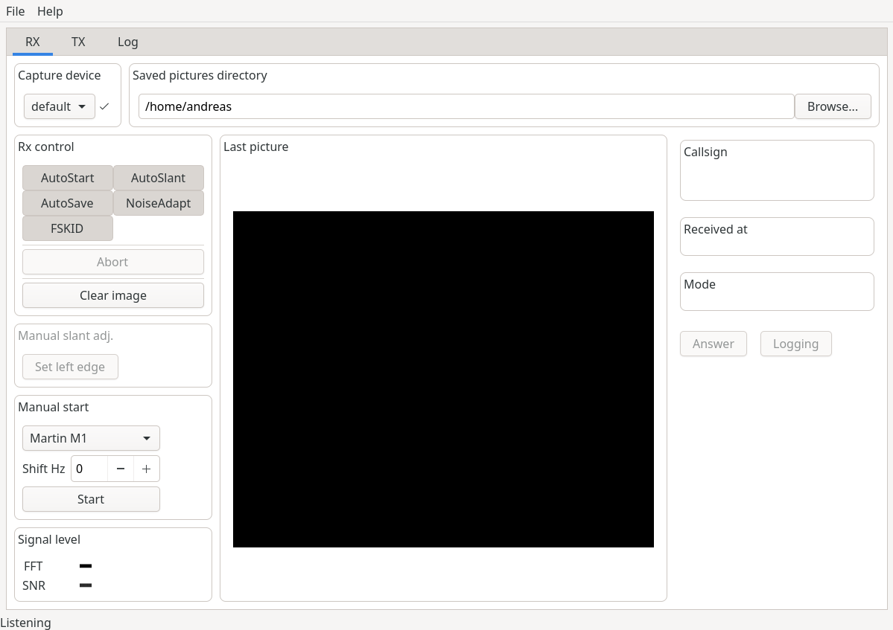
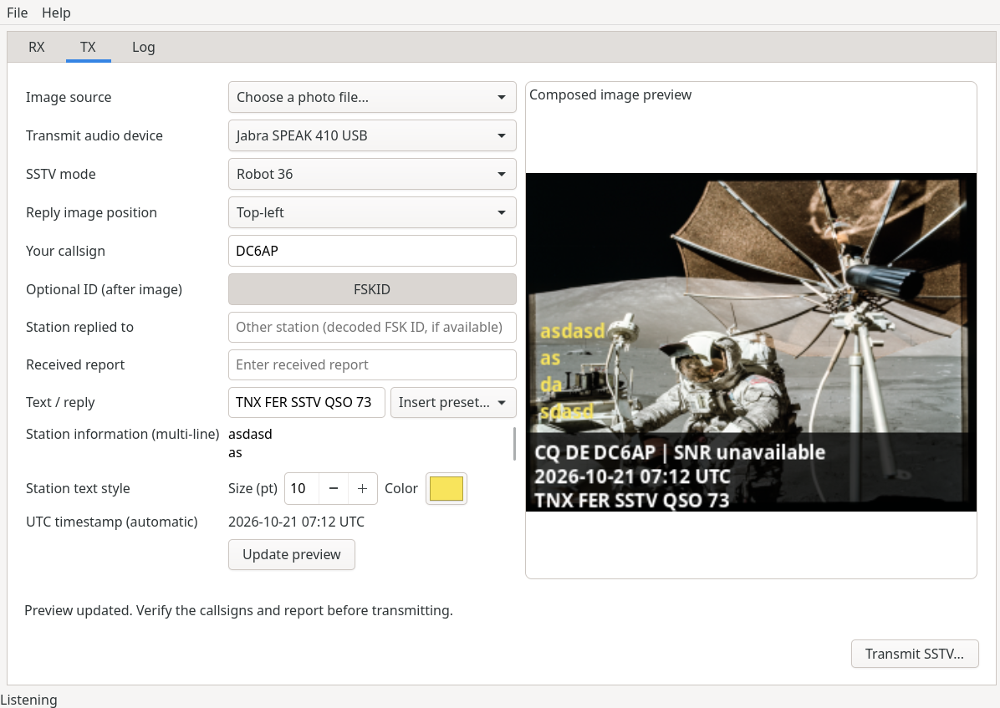

# SSTV - Slowrx

Slowrx is an SSTV encoder/decoder for Linux.

Original created by Oona Räisänen (OH2EIQ [at] sral.fi). I've added TX.

http://windytan.github.io/slowrx/

## Features

- Support for a multitude of modes (see `modespec.c` for a list)
- Detect frequency-shifted signals – no need to fine-tune the radio
- Automatic slant correction, also manual adjustments are simple
- Adaptive noise reduction
- Decode digital FSK ID
- Save received pictures as PNG
- Written in C99

## Requirements

- Linux
- Alsa (`libasound2-dev`)
- Gtk+ 4 (`libgtk-4-dev`)
- FFTW 3 (`libfftw3-dev`)

And, obviously:

- shortwave radio with SSB
- computer with sound card
- means of getting sound from radio to sound card

## Compiling

`make`

## Running

`./sstv`

## Screenshots

